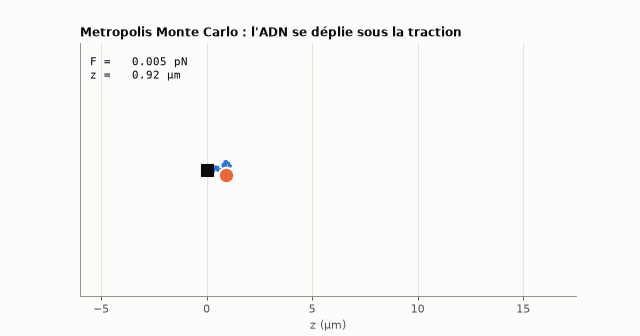
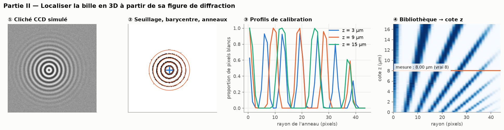
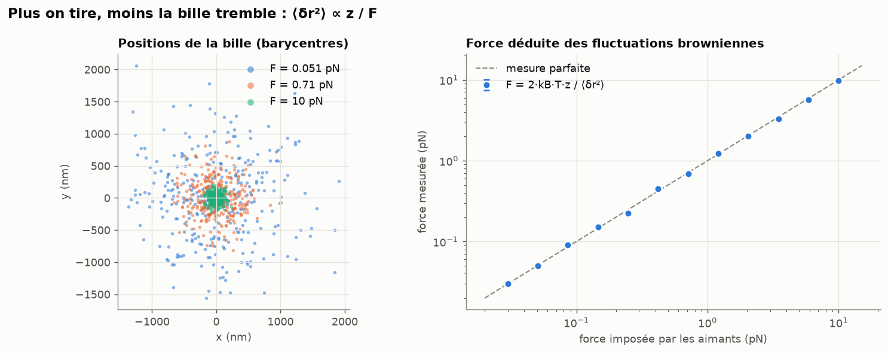
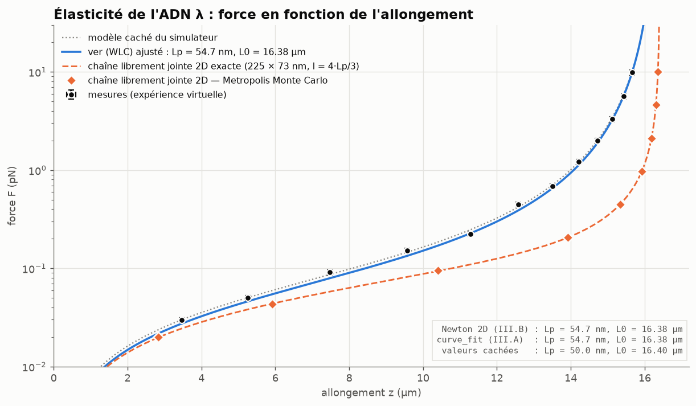
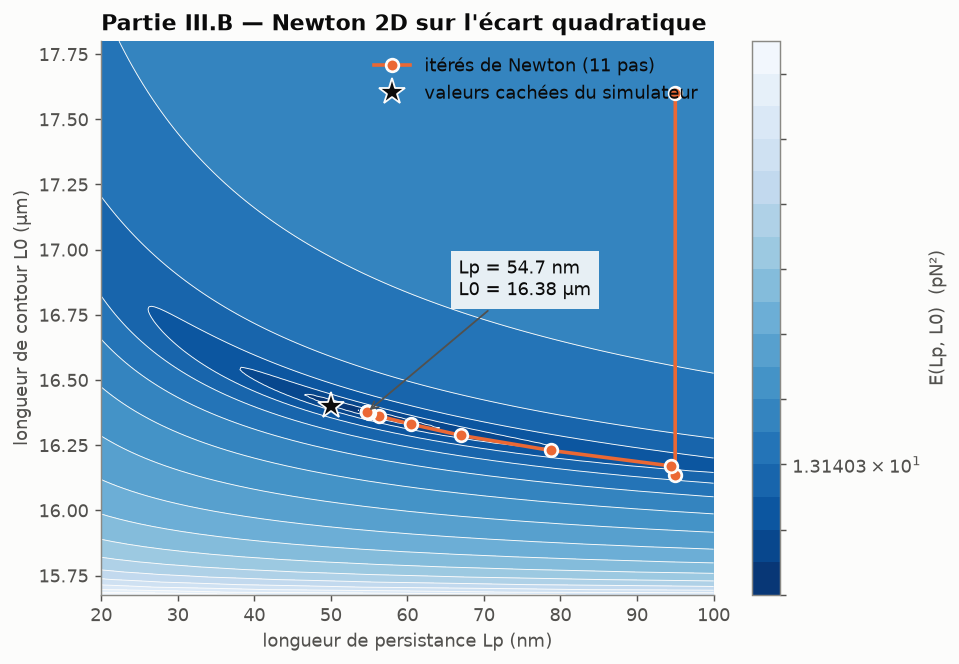
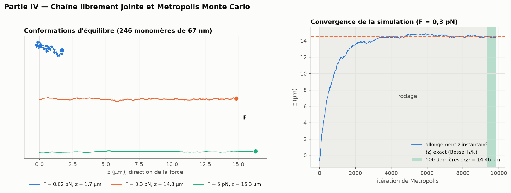

# ADN_elasticity — Élasticité d'un brin d'ADN

Résolution complète et **fonctionnelle** du sujet d'informatique
[Centrale-Supélec 2019 « Élasticité d'un brin d'ADN »](centrale-info-2019-sujet.pdf)
(MP, PC, PSI, TSI), augmentée d'une **expérience de pince magnétique virtuelle**
qui permet d'exécuter toute la chaîne : des clichés de la caméra CCD jusqu'aux
paramètres mécaniques de la molécule.



## L'idée : une expérience qu'on peut vraiment lancer

Le sujet suppose une caméra réelle (`prendre_photo()`) et des mesures que l'on
n'a pas. Ce dépôt les **simule de façon physiquement plausible**
(`experience_virtuelle.py`) :

* un ADN de phage λ dont les paramètres sont **cachés** dans le simulateur
  (Lp = 50 nm, L0 = 16,4 µm) ;
* une bille qui subit le mouvement brownien : raideur transverse F/z, donc
  ⟨δx²⟩ = k_B·T·z/F (équipartition) ;
* une figure de diffraction dont les anneaux s'élargissent avec la cote z,
  plus le bruit du capteur 8 bits.

Le code du sujet analyse ensuite ces images (300 clichés × 12 forces) **sans connaître les paramètres
cachés**, et les retrouve à quelques pour cent près (l'écart sur Lp vient du bruit
statistique de 300 clichés par force) :

| | Lp (nm) | L0 (µm) |
|---|---|---|
| Valeurs cachées du simulateur | 50,0 | 16,40 |
| `ajusteWLC` (curve_fit, III.A) | 54,7 | 16,38 |
| `min_local_2D` (Newton, III.B) | identique à curve_fit | identique |

## Les figures (`python illustrations.py`)

### 1. Localiser la bille en 3D (partie II)
Seuillage, barycentre, découpe en anneaux, puis lecture de la cote z dans une
bibliothèque de profils de calibration (comme sur les vraies pinces magnétiques).


### 2. La force se lit dans le tremblement de la bille
F = 2·k_B·T·z / ⟨δr²⟩ : plus on tire, moins la bille tremble.


### 3. Courbe force-extension et trois modèles
Mesures virtuelles, modèle du ver ajusté, chaîne librement jointe exacte et
simulée par Monte Carlo. Aux fortes forces, la chaîne librement jointe se
redresse beaucoup plus vite que le modèle du ver : c'est pourquoi les
biophysiciens ont adopté ce dernier pour l'ADN.


### 4. Newton 2D sur l'écart quadratique E(Lp, L0)
Le minimum est au fond d'une vallée étroite et courbée ; la recherche
linéaire ajoutée à Newton l'y conduit en 11 pas depuis (95 nm, 17,6 µm).


### 5. Chaîne librement jointe et Metropolis


## Organisation du code

| Fichier | Partie du sujet | Contenu |
|---|---|---|
| `Statistiques.py` | I (Q1–Q3) | `moyenne`, `variance`, `somme` (récursive) |
| `mesures_exp.py` | II.A (Q4–Q7) | `seuillage`, `pixel_centre_bille`, `positions`, `fluctuations`, force déduite des fluctuations |
| `allongement_ADN.py` | II.B (Q8–Q9) | `profil` (vectorisé + version à boucles), calibration et `cote_bille` |
| `calcul_parametres_ADN.py` | III.A (Q10–Q11) | `force` (modèle du ver), `extension_wlc` (inverse), `ajusteWLC` |
| `algo_min_local.py` | III.B.1 (Q12–Q16) | `derive`, `derive_seconde`, `min_local` + réponses Q12/Q13 |
| `algo_mini_2D.py` | III.B.2 (Q17–Q19) | `grad`, `hessienne`, `min_local_2D` + démonstration Q17 |
| `modelisation_plane.py` | IV.A (Q20–Q22) | `conformation`, `allongement`, `nouvelle_conformation` |
| `MMC.py` | IV.B–C (Q23–Q24) | `selection_conformation`, `monte_carlo` + solution exacte (Bessel) |
| `experience_virtuelle.py` | — | pince magnétique simulée, `prendre_photo()` |
| `illustrations.py` | — | génère toutes les figures |
| `tests/` | — | 17 tests (exemples de l'énoncé + validations physiques) |

## Utilisation

```bash
pip install -r requirements.txt
python -m pytest -q            # 17 tests, ~3 s
python illustrations.py        # régénère figures/ (~1 min ; --rapide pour un aperçu)
python MMC.py                  # chaque module a une petite démonstration
```

## Ce qui a été corrigé par rapport à la version initiale

* **`MMC.py` ne s'exécutait pas** : `conformation`, `allongement`,
  `nouvelle_conformation` n'étaient pas importées.
* **`min_local_2D` était faux** : la « jacobienne » était le gradient remodelé
  en 2×2 (erreur à l'exécution). Elle est remplacée par la hessienne (Q17), avec
  recherche linéaire et repli sur la descente de gradient.
* **`derive` divisait par zéro en x = 0** (le pas relatif x·h s'annule), ce qui
  faisait planter l'exemple `min_local(..., x0=0.0)`.
* `derive_seconde` utilisait h = 1e-5 : erreur d'arrondi en ε/h² ≈ 1e-6 ; le pas
  optimal est ε^(1/4) ≈ 1e-4.
* **`ajusteWLC` ne convergeait pas en unités SI** (Lp ≈ 5e-8 avec p0 = 1) et le
  modèle diverge si L0 < max(z) : ajustement en pN/nm/µm avec bornes.
* `pixel_centre_bille` tronquait au lieu de prendre le pixel *le plus proche*.
* `profil` : double boucle Python remplacée par `np.bincount` (même complexité
  O(p² + n), sans boucle Python), version à boucles conservée pour la comparaison.
* Les exemples s'exécutaient à chaque `import` : ils sont passés sous
  `if __name__ == "__main__"` ; le code dupliqué entre fichiers est supprimé.
* `monte_carlo` : file `deque(maxlen=500)` en O(1) au lieu de `pop(0)` en O(n),
  et garde-fou `max_iter`.

## Trois remarques de physique révélées par la simulation

1. **Le critère de convergence du sujet peut mentir.** À forte force presque
   tous les essais sont rejetés : la chaîne se fige loin de l'équilibre, la
   variance sur 500 itérations devient minuscule et le critère « variance < ε »
   se déclenche trop tôt. D'où le paramètre `iterations_min` (rodage).
   Inversement, ε doit dépasser la variance thermique d'équilibre
   (`variance_equilibre`), sinon la simulation ne s'arrête jamais.
2. **500 états ne suffisent pas pour une moyenne fiable à faible force** : z est
   corrélé sur ~n itérations. Les figures moyennent donc une longue phase de
   production, et l'accord avec la solution exacte ⟨cos θ⟩ = I₁(x)/I₀(x),
   x = F·l/(k_B·T), devient meilleur que 1 %.
3. **Une chaîne plane n'est pas une chaîne 3D.** Pour reproduire le modèle du
   ver aux faibles forces, les monomères de la chaîne plane doivent mesurer
   l = 4·Lp/3 (et non la longueur de Kuhn 2·Lp).
